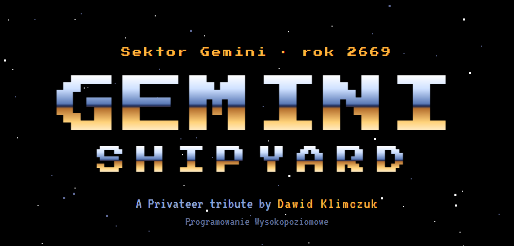
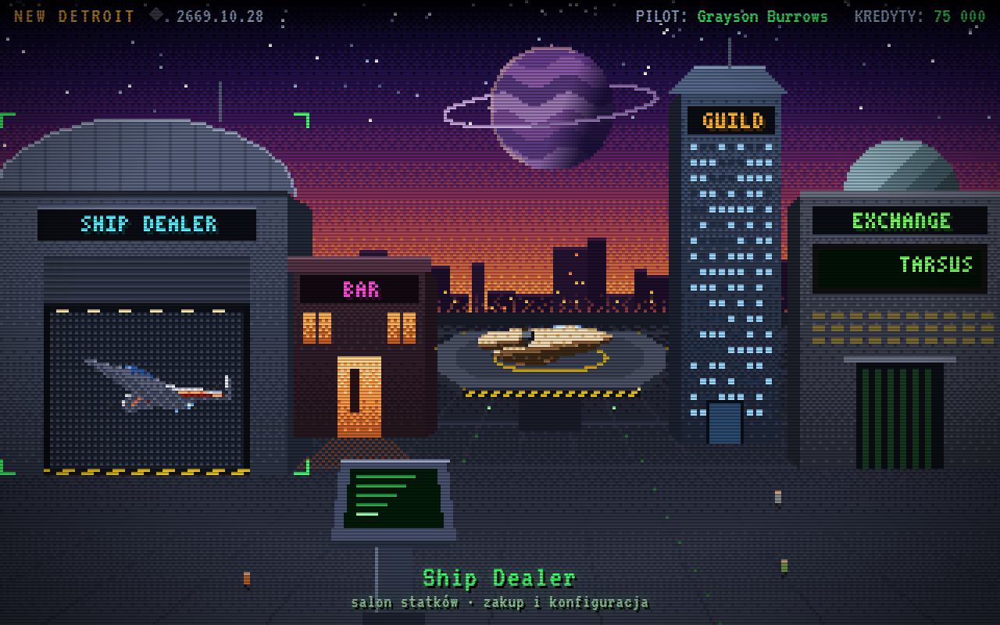
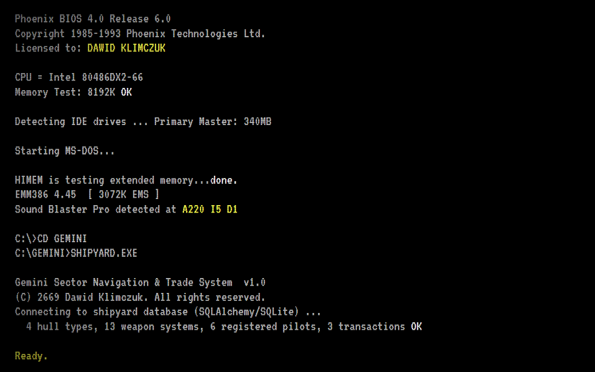
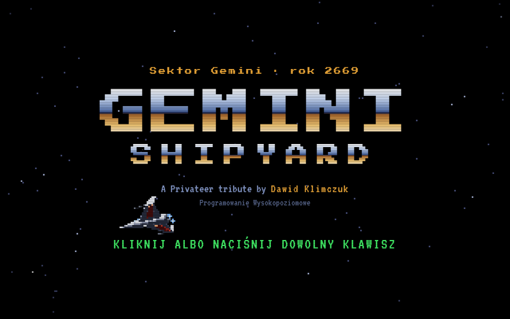
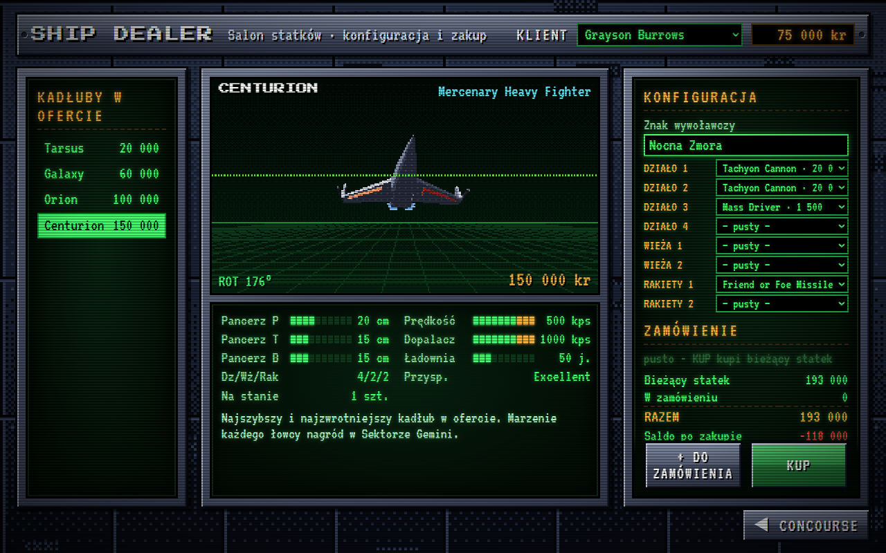
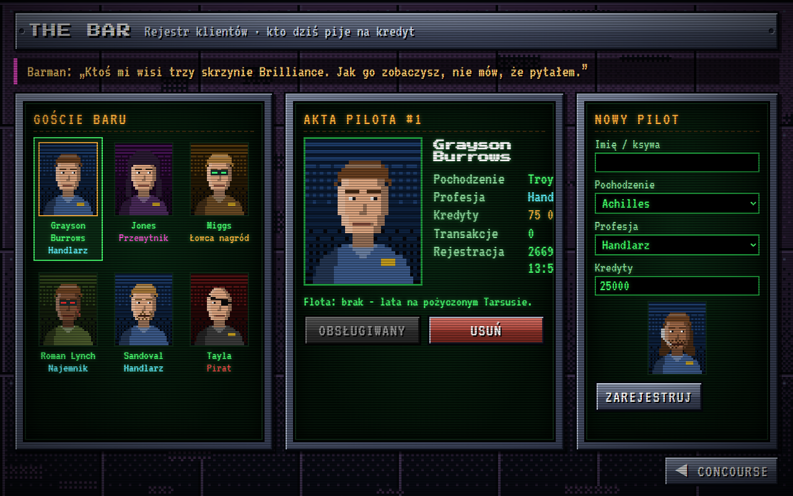
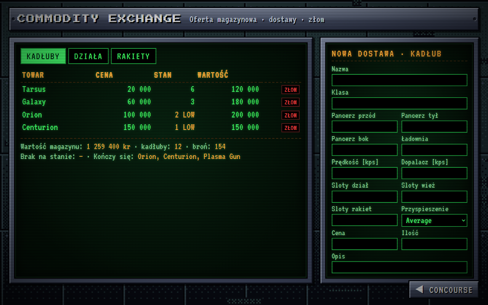
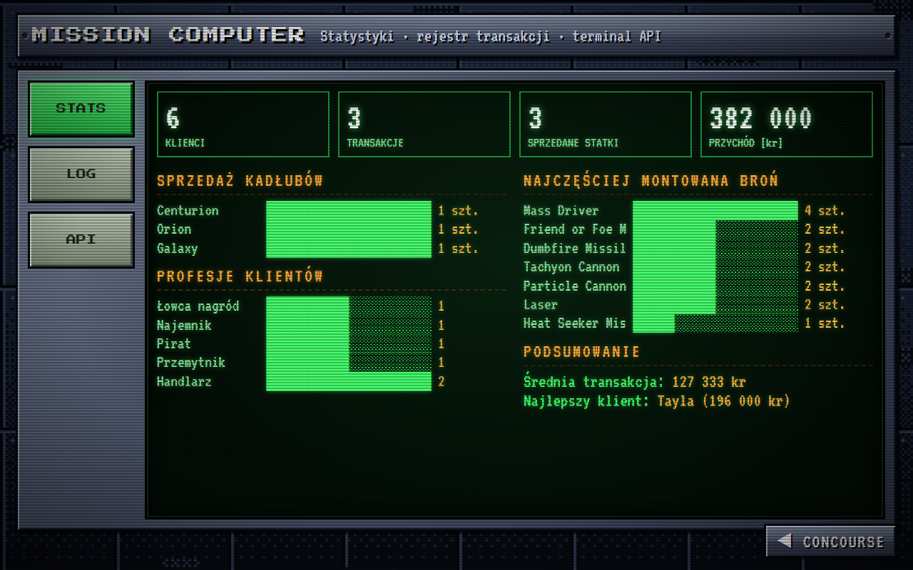
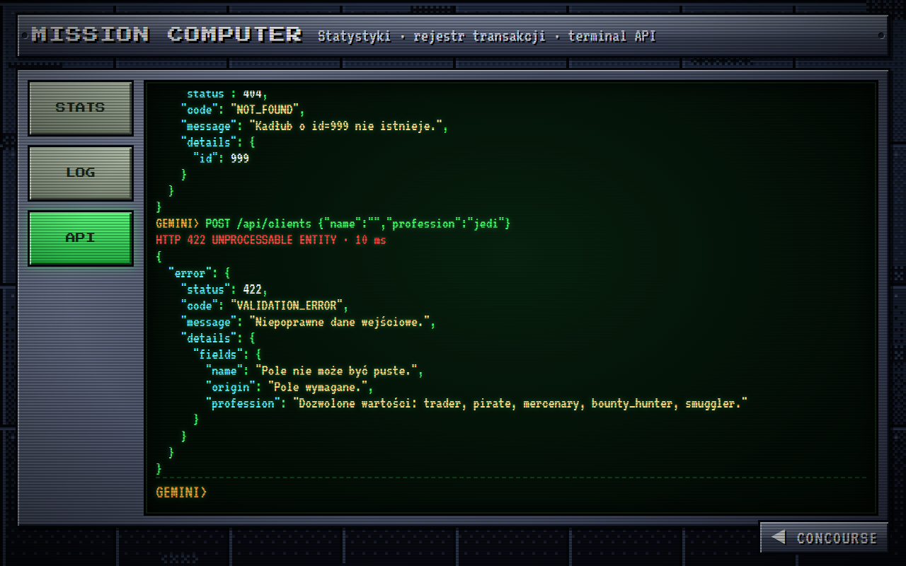
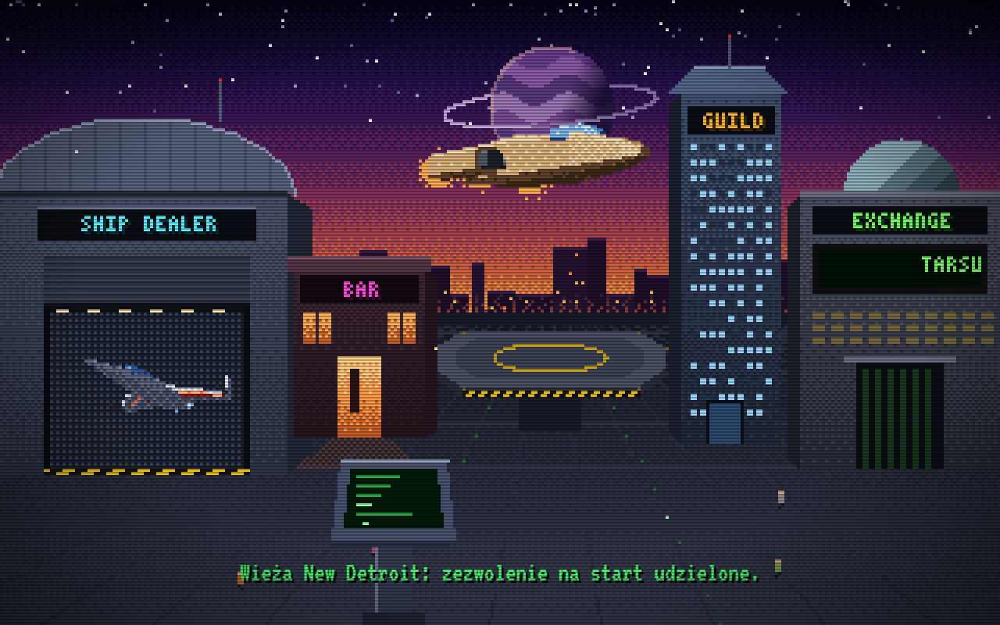

<div align="center">



**Sklep ze statkami kosmicznymi z *Wing Commander: Privateer***




</div>

```
Phoenix BIOS 4.0 Release 6.0
Copyright 1985-1993 Phoenix Technologies Ltd.
Licensed to: DAWID KLIMCZUK

Memory Test: 8192K OK
Sound Blaster Pro detected at A220 I5 D1

C:\>CD GEMINI
C:\GEMINI>TYPE README.TXT
```

## `C:\GEMINI> TYPE OPIS.TXT`

Programowanie Wysokopoziomowe, **Laboratorium 1**: aplikacja WWW do obsługi sklepu ze statkami kosmicznymi.

Backend to **Flask** z **SQLAlchemy** (SQLite), REST API w JSON, transakcyjna operacja zakupu i spójna obsługa błędów.
Frontend to hołd dla interfejsu Privateera z 1993 roku. Gracz ląduje w bazie New Detroit, chodzi po concourse i odwiedza Ship Dealera, bar, giełdę oraz komputer misji.

Grafika nie korzysta z żadnych plików z gry. Wszystko jest generowane w kodzie:

- concourse rysowany co do piksela w 320×200, z ditheringiem Bayera i paletą VGA;
- modele 3D statków z własnym rasteryzatorem: płaskie cieniowanie, algorytm malarza, bez WebGL;
- pikselowe portrety pilotów generowane z imienia i profesji;
- dźwięk syntezowany w WebAudio: piski PC-speakera i arpeggio w stylu FM.

## `C:\GEMINI> SHIPYARD.EXE /INSTALL`

```bash
git clone https://github.com/DawidKlimczuk/Wing_commander.git
cd Wing_commander
python -m venv .venv
.venv\Scripts\activate            # Linux/macOS: source .venv/bin/activate
pip install -r requirements.txt
python run.py                     # → http://127.0.0.1:5000
```

```bash
pytest -q                         # 27 passed
```

Baza `instance/gemini.db` tworzy się i wypełnia danymi przy pierwszym starcie. Usunięcie pliku przywraca stan początkowy.

| Klawisz | Akcja |
|:---:|---|
| `ESC` | powrót na concourse |
| `M` | dźwięk wł./wył. |
| `C` | efekt monitora CRT |
| `?scene=dealer` | pominięcie intro (także `bar`, `exchange`, `computer`) |

## `C:\GEMINI> DIR /SCREENS`

<table>
<tr>
<td width="50%"><br><sub><b>BOOT</b>: BIOS, MS-DOS i połączenie z bazą (liczby są prawdziwe, z API)</sub></td>
<td width="50%"><br><sub><b>INTRO</b>: gwiazdy i przelatujący Centurion</sub></td>
</tr>
<tr>
<td><br><sub><b>SHIP DEALER</b>: obracany model 3D, statystyki, konfiguracja slotów, zakup</sub></td>
<td><br><sub><b>BAR</b>: rejestr klientów z generowanymi portretami</sub></td>
</tr>
<tr>
<td><br><sub><b>COMMODITY EXCHANGE</b>: oferta magazynowa, dostawy, złomowanie</sub></td>
<td><br><sub><b>MISSION COMPUTER</b>: statystyki sprzedaży</sub></td>
</tr>
<tr>
<td><br><sub><b>MERCHANTS' GUILD</b>: terminal do żądań REST na żywo</sub></td>
<td><br><sub><b>LAUNCH</b>: start z lądowiska statkiem kupionym przez pilota</sub></td>
</tr>
</table>

## `C:\GEMINI> TYPE WYMAGANIA.TXT`

| # | Wymaganie | Realizacja |
|:-:|---|---|
| 1 | Flask + baza relacyjna przez SQLAlchemy | SQLite, Flask-SQLAlchemy, fabryka aplikacji |
| 1a | Kadłub: nazwa, pancerz, ładownia, silnik, sloty, cena | `Hull`: pancerz przód/tył/bok, prędkość, dopalacz, przyspieszenie, sloty dział/wież/rakiet |
| 1b | Broń: rodzaj, uszkodzenia, amunicja, cena | `Weapon`: `energy` / `missile`, statystyki z plików gry |
| 1c | Klient: imię, pochodzenie, profesja | `Client`: handlarz, pirat, najemnik, łowca nagród, przemytnik |
| 2 | Model ORM | 6 klas z relacjami ([app/models.py](app/models.py)) |
| 3 | CRUD GET / POST / DELETE w JSON | kadłuby, broń, klienci; każda odpowiedź (także DELETE i błędy) w JSON |
| 4 | Zakup: kontrahent i statek/statki ze szczegółami | `POST /api/purchases`: wiele statków, każdy z własnym uzbrojeniem; operacja atomowa |
| 5 | Oferta magazynowa i statystyki | `GET /api/inventory`, `GET /api/stats` |
| 6 | Obsługa błędów | jeden format JSON, kody 400–500, walidacja wszystkich pól naraz |

## `C:\GEMINI> TYPE API.TXT`

| Metoda | Ścieżka | Opis |
|---|---|---|
| `GET` | `/api/` | spis endpointów |
| `GET` `POST` | `/api/hulls` | kadłuby (`?in_stock=1`) |
| `GET` `DELETE` | `/api/hulls/<id>` | |
| `GET` `POST` | `/api/weapons` | broń (`?kind=energy\|missile`) |
| `GET` `DELETE` | `/api/weapons/<id>` | |
| `GET` `POST` | `/api/clients` | klienci (`?profession=pirate`) |
| `GET` `DELETE` | `/api/clients/<id>` | klient z historią zakupów |
| `GET` `POST` | `/api/purchases` | transakcje / **zakup** (`?client_id=`) |
| `GET` | `/api/purchases/<id>` | manifest transakcji |
| `GET` | `/api/inventory` | stan magazynu (`?low_stock_threshold=`) |
| `GET` | `/api/stats` | statystyki sprzedaży |

**Zakup:**

```json
POST /api/purchases
{
  "client_id": 2,
  "ships": [{
    "hull_id": 4,
    "callsign": "Nocna Zmora",
    "loadout": [
      {"weapon_id": 6,  "mount": "gun",     "quantity": 2},
      {"weapon_id": 12, "mount": "missile", "quantity": 1}
    ]
  }]
}
```

Przed zapisem serwer sprawdza zgodność broni z typem slotu, limit slotów kadłuba, stany magazynowe dla całego zamówienia i saldo klienta. Dopiero potem zdejmuje towar ze stanu i pobiera kredyty, w jednej transakcji.

**Usunięcie** zwraca `200` z danymi usuniętego obiektu:

```json
{"message": "Klient 'Test' został usunięty.", "deleted": {"id": 7, "name": "Test", "...": "..."}}
```

## `C:\GEMINI> TYPE ERRORS.TXT`

```json
{"error": {"status": 402, "code": "INSUFFICIENT_CREDITS",
           "message": "Brak środków. Potrzeba 100 000 kr, a Sandoval ma 15 000 kr.",
           "details": {"required": 100000, "available": 15000, "missing": 85000}}}
```

| Kod | Kiedy |
|---|---|
| `400` `MALFORMED_JSON` `BAD_FILTER` | zepsuty JSON, zły parametr zapytania |
| `402` `INSUFFICIENT_CREDITS` | klienta nie stać na zamówienie |
| `404` `NOT_FOUND` | nieistniejący obiekt lub ścieżka |
| `405` `METHOD_NOT_ALLOWED` | z listą dozwolonych metod |
| `409` `CONFLICT` `OUT_OF_STOCK` `INTEGRITY_ERROR` | duplikat nazwy, usuwanie sprzedanego towaru, brak na stanie |
| `415` `UNSUPPORTED_MEDIA_TYPE` | ciało żądania nie jest JSON-em |
| `422` `VALIDATION_ERROR` `SLOT_LIMIT_EXCEEDED` `INCOMPATIBLE_MOUNT` | walidacja; wszystkie błędne pola naraz, także zagnieżdżone (`ships[0].loadout[1].mount`) |
| `500` `INTERNAL_ERROR` | nieobsłużony wyjątek (z rollbackiem sesji) |

W terminalu Merchants' Guild polecenie `demo` wysyła serię błędnych żądań i pokazuje odpowiedzi na żywo.

## `C:\GEMINI> TREE`

```
app/
├── __init__.py        fabryka aplikacji
├── models.py          ORM: Hull, Weapon, Client, Transaction, PurchasedShip, MountedWeapon
├── errors.py          wyjątki API i globalne handlery błędów
├── validation.py      walidacja wejścia (zbiera wszystkie błędy naraz)
├── seed.py            dane startowe: oferta stoczni i piloci z Sektora Gemini
├── api/
│   ├── catalog.py     CRUD: kadłuby, broń, klienci
│   ├── trade.py       operacja zakupu
│   └── stats.py       magazyn i statystyki
├── templates/index.html
└── static/
    ├── css/privateer.css
    └── js/
        ├── pixel.js       dithering, wielokąty, czcionka 3×5
        ├── ships3d.js     modele statków i rasteryzator
        ├── concourse.js   baza New Detroit z hotspotami
        ├── scenes.js      boot, intro, start z lądowiska
        ├── portraits.js   portrety pilotów
        ├── audio.js       synteza dźwięku
        └── main.js        sceny, sklep, bar, magazyn, komputer, terminal
tests/test_api.py      27 testów API
```

## `C:\GEMINI> TYPE CREDITS.TXT`

```
GEMINI SHIPYARD v1.0
Autor .............. Dawid Klimczuk
Przedmiot .......... Programowanie Wysokopoziomowe · Laboratorium 1
```

Dane statków: [wcnews.com](https://www.wcnews.com/ships/p1centurion.shtml). Statystyki dział: [apocalyptech.com/games/privgun](https://apocalyptech.com/games/privgun/).
Ceny kadłubów i rakiet są orientacyjne. *Wing Commander* i *Privateer* to znaki towarowe ich właścicieli; projekt jest niekomercyjnym hołdem dla gry.

```
C:\GEMINI>_
```
