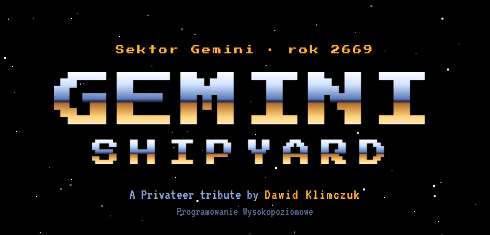
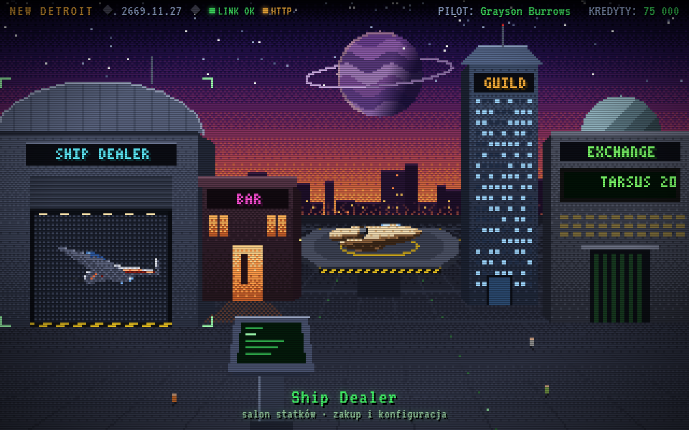
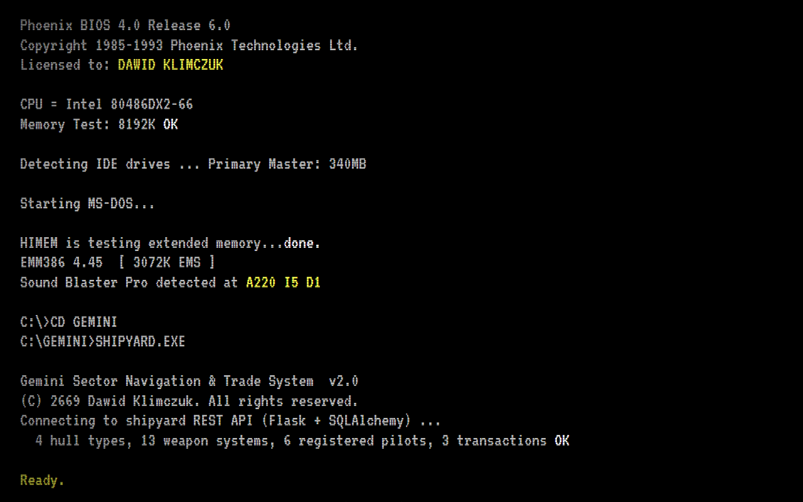
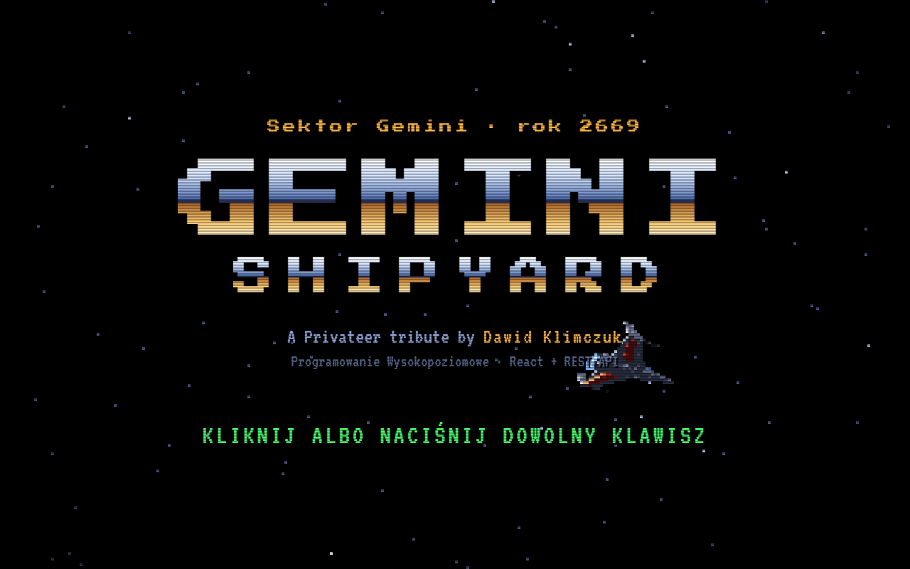
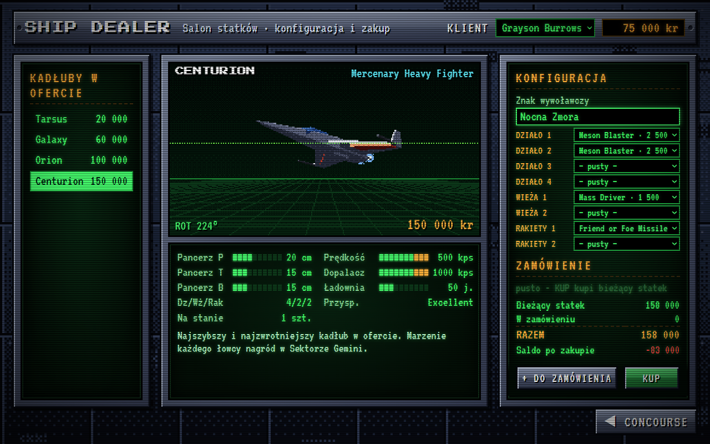
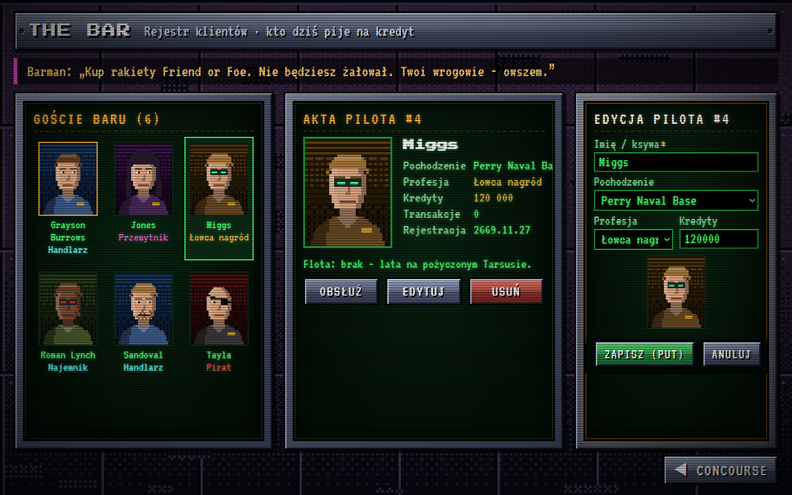
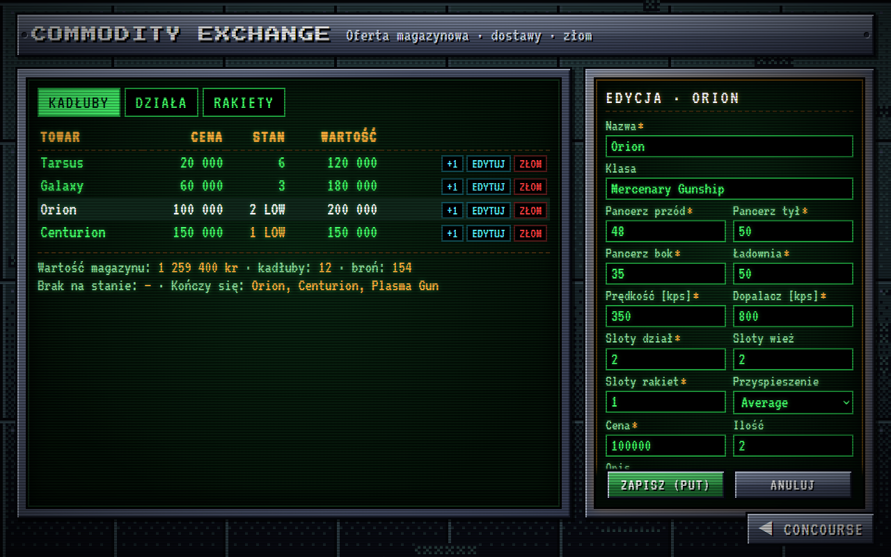
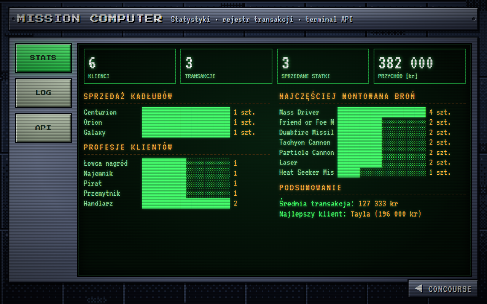
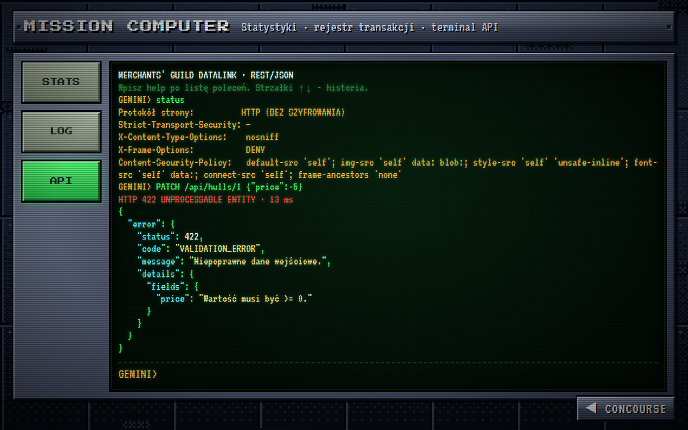
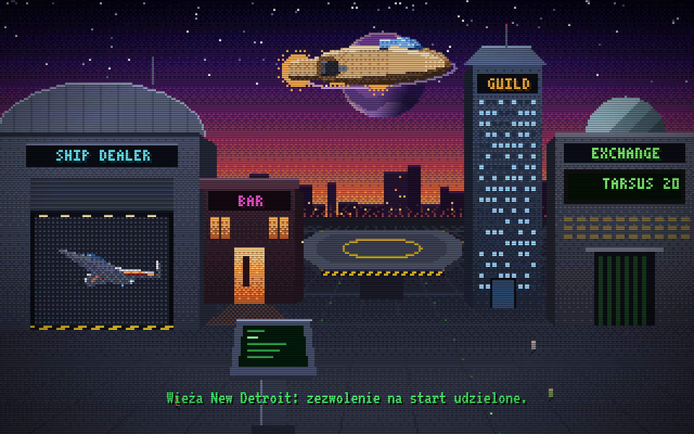

<div align="center">



**Sklep ze statkami kosmicznymi z *Wing Commander: Privateer***

### [▶ ZAGRAJ ONLINE: wing-commander.onrender.com](https://wing-commander.onrender.com/)

<sub>Darmowy hosting usypia aplikację po bezczynności, więc pierwsze wejście może potrwać ok. 50 s.</sub>




</div>

```
Phoenix BIOS 4.0 Release 6.0
Copyright 1985-1993 Phoenix Technologies Ltd.
Licensed to: DAWID KLIMCZUK

Memory Test: 8192K OK
Sound Blaster Pro detected at A220 I5 D1

C:\>CD GEMINI
C:\GEMINI>TYPE README.TXT
```

## `C:\GEMINI> TYPE OPIS.TXT`

Programowanie Wysokopoziomowe, **Laboratorium 2**: aplikacja WWW do obsługi sklepu ze statkami kosmicznymi, przerobiona na architekturę REST + osobny klient.

- **Serwer:** Flask + SQLAlchemy (SQLite). Zwraca wyłącznie JSON, ma pełny CRUD (GET / POST / PUT / PATCH / DELETE), CORS i nagłówki bezpieczeństwa, a na produkcji działa tylko przez HTTPS.
- **Klient:** aplikacja **React** (Vite), która pobiera dane z API i wysyła operacje CRUD. Jest hołdem dla interfejsu Privateera z 1993 roku. Gracz ląduje w bazie New Detroit, chodzi po concourse i odwiedza Ship Dealera, bar, giełdę oraz komputer misji.

Laboratorium 1 (Flask + szablon HTML) jest w historii gita, w commitach przed wersją 2.0.

Grafika nie korzysta z żadnych plików z gry. Wszystko jest generowane w kodzie:

- concourse rysowany co do piksela w 320×200, z ditheringiem Bayera i paletą VGA;
- modele 3D statków z własnym rasteryzatorem: płaskie cieniowanie, algorytm malarza, bez WebGL;
- pikselowe portrety pilotów generowane z imienia i profesji;
- dźwięk syntezowany w WebAudio: piski PC-speakera i arpeggio w stylu FM.

## `C:\GEMINI> SHIPYARD.EXE /INSTALL`

Potrzebny jest Python 3.10+ i Node.js 20.19+.

**1. Serwer API (terminal nr 1)**

```bash
git clone https://github.com/DawidKlimczuk/Wing_commander.git
cd Wing_commander
python -m venv .venv
.venv\Scripts\activate            # Linux/macOS: source .venv/bin/activate
pip install -r requirements.txt
python run.py                     # API → http://127.0.0.1:5000/api/
```

**2. Klient React (terminal nr 2)**

```bash
cd frontend
npm install
npm run dev                       # → http://localhost:5173
```

Vite przekazuje zapytania `/api/...` do Flaska (proxy), więc klient i serwer działają jak jedna strona.

**Wersja „produkcyjna”** (jeden serwer, tak jak na Renderze):

```bash
cd frontend && npm run build && cd ..
python run.py                     # Flask podaje zbudowanego Reacta z frontend/dist → http://127.0.0.1:5000
```

```bash
pytest -q                         # 42 passed
```

Baza `instance/gemini.db` tworzy się i wypełnia danymi przy pierwszym starcie. Usunięcie pliku przywraca stan początkowy.

## `C:\GEMINI> TYPE HTTPS.TXT`

| Gdzie | Jak |
|---|---|
| Render (produkcja) | `FORCE_HTTPS=1`: każde żądanie po `http://` dostaje przekierowanie **308** na `https://` (308 zostawia metodę, więc POST dalej jest POST-em). `ProxyFix` odczytuje `X-Forwarded-Proto` od proxy Rendera |
| Lokalnie, serwer | `python run.py --https`: certyfikat generowany w locie (`cryptography`); przeglądarka pokaże ostrzeżenie. Własny certyfikat, np. z `mkcert`: zmienne `SSL_CERT` i `SSL_KEY` |
| Lokalnie, klient | `npm run dev:https`: Vite na `https://localhost:5173`. Jeśli Flask też działa po https, ustaw `API_TARGET=https://127.0.0.1:5000` |

Nagłówki dodawane do każdej odpowiedzi:

| Nagłówek | Po co |
|---|---|
| `Strict-Transport-Security` | tylko po https: przeglądarka przez rok sama wybiera https |
| `Content-Security-Policy` | skrypty, style, czcionki i zapytania tylko z własnej domeny (czcionki są w paczce, bez Google Fonts) |
| `X-Content-Type-Options: nosniff` | przeglądarka nie zgaduje typu pliku |
| `X-Frame-Options: DENY` | strony nie da się osadzić w ramce (clickjacking) |
| `Access-Control-Allow-Origin` | CORS tylko dla adresów z listy `CORS_ORIGINS` (domyślnie serwer Vite) |

Na concourse lampki **LINK** i **HTTP/HTTPS** pokazują stan połączenia z API i protokół. W terminalu Merchants' Guild polecenie `status` wypisuje nagłówki bezpieczeństwa z prawdziwej odpowiedzi serwera.

| Klawisz | Akcja |
|:---:|---|
| `ESC` | powrót na concourse |
| `M` | dźwięk wł./wył. |
| `C` | efekt monitora CRT |
| `?scene=dealer` | pominięcie intro (także `bar`, `exchange`, `computer`) |

## `C:\GEMINI> DIR /SCREENS`

<table>
<tr>
<td width="50%"><br><sub><b>BOOT</b>: BIOS, MS-DOS i połączenie z bazą (liczby są prawdziwe, z API)</sub></td>
<td width="50%"><br><sub><b>INTRO</b>: gwiazdy i przelatujący Centurion</sub></td>
</tr>
<tr>
<td><br><sub><b>SHIP DEALER</b>: obracany model 3D, statystyki, konfiguracja slotów, zakup</sub></td>
<td><br><sub><b>BAR</b>: rejestr klientów z portretami, dodawanie, edycja (PUT) i usuwanie</sub></td>
</tr>
<tr>
<td><br><sub><b>COMMODITY EXCHANGE</b>: magazyn, dostawy (POST), edycja (PUT), +1 szt. (PATCH), złom (DELETE)</sub></td>
<td><br><sub><b>MISSION COMPUTER</b>: statystyki sprzedaży</sub></td>
</tr>
<tr>
<td><br><sub><b>MERCHANTS' GUILD</b>: terminal REST, nagłówki bezpieczeństwa i błąd walidacji</sub></td>
<td><br><sub><b>LAUNCH</b>: start z lądowiska statkiem kupionym przez pilota</sub></td>
</tr>
</table>

## `C:\GEMINI> TYPE WYMAGANIA.TXT`

| # | Wymaganie | Realizacja |
|:-:|---|---|
| 1 | Flask + baza relacyjna przez SQLAlchemy | SQLite, Flask-SQLAlchemy, fabryka aplikacji |
| 1a | Kadłub: nazwa, pancerz, ładownia, silnik, sloty, cena | `Hull`: pancerz przód/tył/bok, prędkość, dopalacz, przyspieszenie, sloty dział/wież/rakiet |
| 1b | Broń: rodzaj, uszkodzenia, amunicja, cena | `Weapon`: `energy` / `missile`, statystyki z plików gry |
| 1c | Klient: imię, pochodzenie, profesja | `Client`: handlarz, pirat, najemnik, łowca nagród, przemytnik |
| 2 | Model ORM | 6 klas z relacjami ([app/models.py](app/models.py)) |
| 3 | CRUD GET / POST / DELETE w JSON | kadłuby, broń, klienci; każda odpowiedź (także DELETE i błędy) w JSON |
| 4 | Zakup: kontrahent i statek/statki ze szczegółami | `POST /api/purchases`: wiele statków, każdy z własnym uzbrojeniem; operacja atomowa |
| 5 | Oferta magazynowa i statystyki | `GET /api/inventory`, `GET /api/stats` |
| 6 | Obsługa błędów | jeden format JSON, kody 400–500, walidacja wszystkich pól naraz |

**Laboratorium 2:**

| # | Wymaganie | Realizacja |
|:-:|---|---|
| 1 | Aplikacja w postaci REST, dane w JSON | Flask zwraca tylko JSON; doszły `PUT` / `PATCH`, `/api/meta`, CORS; HTML robi już klient |
| 2 | Klient we frameworku konsumujący dane | React 19 + Vite ([frontend/](frontend/)); dane w kontekście `ShopContext`, zapytania w [api.js](frontend/src/api.js) |
| 3 | Widoki do operacji CRUD | tabela niżej |
| 4 | Obsługa błędów, HTTPS | błędy z serwera przy polach formularza i w okienkach, walidacja przed wysłaniem, timeout, brak sieci, `ErrorBoundary`; HTTPS opisany wyżej |

| Operacja | Gdzie w kliencie |
|---|---|
| **Create** `POST` | Bar → *NOWY PILOT*; Exchange → *NOWA DOSTAWA* (kadłub, działo, rakiety); Ship Dealer → *KUP* (`/api/purchases`) |
| **Read** `GET` | wszystkie widoki: oferta, akta pilota z flotą, magazyn, statystyki, rejestr transakcji |
| **Update** `PUT` | Bar → *EDYTUJ* pilota; Exchange → *EDYTUJ* towar (cały obiekt) |
| **Update** `PATCH` | Exchange → *+1* (zmienia tylko `stock`) |
| **Delete** `DELETE` | Bar → *USUŃ* pilota; Exchange → *ZŁOM* |
| dowolne | Merchants' Guild → terminal, w którym można wpisać każde żądanie ręcznie |

## `C:\GEMINI> TYPE API.TXT`

| Metoda | Ścieżka | Opis |
|---|---|---|
| `GET` | `/api/` | spis endpointów |
| `GET` `POST` | `/api/hulls` | kadłuby (`?in_stock=1`) |
| `GET` `PUT` `PATCH` `DELETE` | `/api/hulls/<id>` | |
| `GET` `POST` | `/api/weapons` | broń (`?kind=energy\|missile`) |
| `GET` `PUT` `PATCH` `DELETE` | `/api/weapons/<id>` | |
| `GET` `POST` | `/api/clients` | klienci (`?profession=pirate`) |
| `GET` `PUT` `PATCH` `DELETE` | `/api/clients/<id>` | klient z historią zakupów |
| `GET` `POST` | `/api/purchases` | transakcje / **zakup** (`?client_id=`) |
| `GET` | `/api/purchases/<id>` | manifest transakcji |
| `GET` | `/api/inventory` | stan magazynu (`?low_stock_threshold=`) |
| `GET` | `/api/stats` | statystyki sprzedaży |
| `GET` | `/api/meta` | słowniki dla klienta: pochodzenie, profesje, przyspieszenie |

**PUT a PATCH:** `PUT` podmienia cały obiekt, więc wymaga wszystkich obowiązkowych pól (pominięte opcjonalne wracają do domyślnych). `PATCH` zmienia tylko przesłane pola:

```json
PATCH /api/hulls/3
{"stock": 10, "price": 95000}
```

Przy edycji serwer sprawdza to samo co przy dodawaniu (unikalna nazwa z pominięciem edytowanego obiektu, dopalacz >= prędkość z uwzględnieniem starej wartości) i nie pozwala zmienić rodzaju broni zamontowanej już na sprzedanych statkach (`409`).

**Zakup:**

```json
POST /api/purchases
{
  "client_id": 2,
  "ships": [{
    "hull_id": 4,
    "callsign": "Nocna Zmora",
    "loadout": [
      {"weapon_id": 6,  "mount": "gun",     "quantity": 2},
      {"weapon_id": 12, "mount": "missile", "quantity": 1}
    ]
  }]
}
```

Przed zapisem serwer sprawdza zgodność broni z typem slotu, limit slotów kadłuba, stany magazynowe dla całego zamówienia i saldo klienta. Dopiero potem zdejmuje towar ze stanu i pobiera kredyty, w jednej transakcji.

**Usunięcie** zwraca `200` z danymi usuniętego obiektu:

```json
{"message": "Klient 'Test' został usunięty.", "deleted": {"id": 7, "name": "Test", "...": "..."}}
```

## `C:\GEMINI> TYPE ERRORS.TXT`

```json
{"error": {"status": 402, "code": "INSUFFICIENT_CREDITS",
           "message": "Brak środków. Potrzeba 100 000 kr, a Sandoval ma 15 000 kr.",
           "details": {"required": 100000, "available": 15000, "missing": 85000}}}
```

| Kod | Kiedy |
|---|---|
| `400` `MALFORMED_JSON` `BAD_FILTER` | zepsuty JSON, zły parametr zapytania |
| `402` `INSUFFICIENT_CREDITS` | klienta nie stać na zamówienie |
| `404` `NOT_FOUND` | nieistniejący obiekt lub ścieżka |
| `405` `METHOD_NOT_ALLOWED` | z listą dozwolonych metod |
| `409` `CONFLICT` `OUT_OF_STOCK` `INTEGRITY_ERROR` | duplikat nazwy, usuwanie sprzedanego towaru, brak na stanie |
| `415` `UNSUPPORTED_MEDIA_TYPE` | ciało żądania nie jest JSON-em |
| `422` `VALIDATION_ERROR` `SLOT_LIMIT_EXCEEDED` `INCOMPATIBLE_MOUNT` | walidacja; wszystkie błędne pola naraz, także zagnieżdżone (`ships[0].loadout[1].mount`) |
| `500` `INTERNAL_ERROR` | nieobsłużony wyjątek (z rollbackiem sesji) |

W terminalu Merchants' Guild polecenie `demo` wysyła serię błędnych żądań i pokazuje odpowiedzi na żywo.

**Po stronie klienta:**

| Sytuacja | Co widzi użytkownik |
|---|---|
| `422` z listą pól | czerwona ramka i komunikat pod konkretnym polem formularza |
| inne błędy API (`402`, `404`, `409`...) | okienko *TRANSMISJA ODRZUCONA* z komunikatem, szczegółami i kodem HTTP |
| serwer nie odpowiada / brak sieci | okienko *BRAK ŁĄCZNOŚCI*, lampka **LINK DOWN** na concourse |
| zapytanie trwa ponad 10 s | przerwane przez `AbortController`, komunikat o przekroczonym czasie |
| odpowiedź nie jest JSON-em (np. strona błędu proxy) | `BAD_RESPONSE` zamiast wysypania się na `JSON.parse` |
| puste wymagane pole, ujemna liczba | błąd przy polu jeszcze przed wysłaniem żądania |
| wyjątek w komponencie React | `ErrorBoundary`: niebieski ekran awarii z przyciskami *SPRÓBUJ PONOWNIE* / *RESTART* zamiast białej strony |

## `C:\GEMINI> TREE`

```
app/                       SERWER REST (Flask)
├── __init__.py            fabryka aplikacji, CORS, HTTPS, nagłówki, podawanie frontend/dist
├── models.py              ORM: Hull, Weapon, Client, Transaction, PurchasedShip, MountedWeapon
├── errors.py              wyjątki API i globalne handlery błędów
├── validation.py          walidacja wejścia (wszystkie błędy naraz, tryb częściowy dla PATCH)
├── seed.py                dane startowe: oferta stoczni i piloci z Sektora Gemini
└── api/
    ├── __init__.py        spis endpointów, /api/meta
    ├── catalog.py         CRUD: kadłuby, broń, klienci (GET/POST/PUT/PATCH/DELETE)
    ├── trade.py           operacja zakupu
    └── stats.py           magazyn i statystyki
frontend/                  KLIENT (React + Vite)
├── vite.config.js         proxy /api → Flask, tryb https
└── src/
    ├── main.jsx           start aplikacji, czcionki, style
    ├── App.jsx            ekran 1280×800, przejścia między scenami, klawiatura
    ├── api.js             fetch, ApiError, timeout, obsługa braku sieci
    ├── context/
    │   ├── ShopContext.jsx    dane z serwera i aktualny klient
    │   └── DialogContext.jsx  okienka i wyświetlanie błędów API
    ├── components/        Room, FormFields, Portrait, Meter, AnimatedNumber, ErrorBoundary
    ├── scenes/            Boot, Intro, Concourse, Dealer, Bar, Exchange, Computer, Launch
    ├── engine/            grafika i dźwięk (bez Reacta)
    │   ├── pixel.js       dithering, wielokąty, czcionka 3×5
    │   ├── ships3d.js     modele statków i rasteryzator
    │   ├── concourse.js   baza New Detroit z hotspotami
    │   ├── scenes.js      boot, intro, start z lądowiska
    │   ├── rooms.js       tła pomieszczeń
    │   ├── portraits.js   portrety pilotów
    │   └── audio.js       synteza dźwięku
    └── styles/privateer.css
tests/test_api.py          42 testy API
```

## `C:\GEMINI> TYPE CREDITS.TXT`

```
GEMINI SHIPYARD v2.0
Autor .............. Dawid Klimczuk
Przedmiot .......... Programowanie Wysokopoziomowe · Laboratorium 2
```

Dane statków: [wcnews.com](https://www.wcnews.com/ships/p1centurion.shtml). Statystyki dział: [apocalyptech.com/games/privgun](https://apocalyptech.com/games/privgun/).
Ceny kadłubów i rakiet są orientacyjne. *Wing Commander* i *Privateer* to znaki towarowe ich właścicieli; projekt jest niekomercyjnym hołdem dla gry.

```
C:\GEMINI>_
```
